# RPD-AI: technical progress report

**Baseline: 1 September 2026 · Current snapshot: 19 October 2026**

Repository: `JuliaMazine/rpd-ai-prototype`.

## 1. Scope and main result

At the start of autumn, RPD-AI already provided an end-to-end prototype for preparing a Russian university course working program (РПД): a teacher could create a course, upload text materials, generate and edit a draft, download DOCX, and submit it to a methodist for feedback. Autumn development extended that prototype with structured course information, additional document formats, local model generation, validation of generated teaching content, source provenance, and a competency catalogue. The current working tree additionally contains a local semantic competency-search implementation.

The comparison starts on **1 September 2026**, using the initial version (`163f265`, 23 May) as the baseline, and covers development through **19 October**.

Autumn development spans 19 commits, including merges, through `eaeab71` on 16 October. The latest competency-search work is also included and marked as uncommitted.

## 2. What existed at the start of autumn

The baseline was a Python web application built with FastAPI, Jinja2 templates, SQLAlchemy, and PostgreSQL development infrastructure through Docker Compose. It already included the following:

- Password hashing, cookie-based sessions, teacher and methodist roles, and role selection.
- A teacher dashboard and course ownership checks. Course input consisted of a title and description.
- UTF-8 `.txt` and `.md` uploads, stored on disk with extracted text in the database. Generation required at least one uploaded material.
- Generation through the external VseGPT service using the OpenAI-compatible client, with a static Russian RPD template when settings were missing or generation failed.
- Draft storage, browser viewing and editing, and DOCX download through `python-docx`.
- Submission, methodist feedback, resubmission, and a prototype validation status. These were application states, not official university approval.
- User management, demo account seeding, and automated tests for the initial components.

The original generation path asked the model for free-form RPD text. It did not validate the current structured teaching schema or retain an evidence snapshot linking topics to exact excerpts. The initial interface was mostly English, even though the generated document was Russian. Session configuration used a hard-coded demonstration secret, and database creation and demo seeding happened during application import.

### Teacher workspace and course materials

The original teacher dashboard brought course creation, materials, generation and saved drafts together on one page. After creating a course, the teacher could see its description and the list of uploaded files. Each course had its own upload action and draft list, so several courses could be managed through the same account. Access checks associated courses with their assigned teachers.

Uploads were limited to plain-text and Markdown files, but the core materials-to-draft flow was already in place: file contents were decoded, saved as extracted text and collected for the generation request. The dashboard withheld the generation action until the course had at least one material. The autumn PDF, Word, notebook and presentation support extended this existing flow.

### Generation, saved drafts and manual editing

Generation combined the course title, description and uploaded material text with a Russian RPD prompt. That prompt requested the title block and main program sections, including objectives, learning outcomes, workload, syllabus, literature, resources and assessment. VseGPT supplied the model response when configured; a built-in template provided a fallback. Each generation created a new named draft in the course’s draft list, retaining earlier drafts rather than replacing them.

The teacher could open a draft in a read view or edit its full text in a large browser text area. Saving updated the stored draft. The draft list exposed the name, workflow status, feedback availability and available actions. DOCX download was already accessible from both the dashboard and draft screens, allowing the teacher to continue working in a word processor. The original export applied basic heading and bullet formatting and could append methodist feedback on a separate page.

### Methodist review and the revision cycle

The methodist had a separate dashboard with an inbox of drafts awaiting review. It showed the draft, course, status and whether feedback had been saved, together with actions to view, download, write feedback or mark the RPD as validated within the application.

Feedback entry was a separate screen containing the draft text and a comment field. The methodist first saved comments, then marked feedback as given to return the draft to the teacher. The teacher could read the comments, revise the text and resubmit it. The existing status sequence was **Editing → Submitted for review → Feedback given → Resubmitted for review**, with **Validated** available to the methodist. This review loop was already part of the starting application.

### Accounts, persistence and implementation

Accounts could carry teacher and methodist roles, with role selection when needed. User-management screens and demo account creation supported trying the workflow with multiple users. SQLAlchemy models stored users, role assignments, course-teacher links, courses, materials and drafts. A draft already held its content, feedback, status and creation time; source-evidence metadata was added later. Uploaded files were retained on disk, while PostgreSQL was provided for local development through Docker Compose.

Taken together, the starting version already supported the full preparation-and-review cycle. Autumn work made course input more precise, broadened the usable teaching materials and improved how generation and its sources could be checked.

## 3. Before-and-after comparison

| Area | Start of autumn: 1 September | Current snapshot: 19 October | Status of addition |
| --- | --- | --- | --- |
| Main workflow | Create course, upload, generate, edit, export, review | Same workflow with richer inputs and review information | Baseline retained |
| Course information | Title and description | Program, semester, credits, assessment format, topics, total/contact/independent hours, workload confirmation | Committed |
| Interface | Mostly English controls | Russian forms, hints, review statuses and errors | Committed |
| Upload formats | TXT, Markdown | TXT, Markdown, PDF, DOCX, IPYNB, PPTX | Committed |
| Upload handling | Original filename used for storage; simple text decoding | Generated storage names, validation before saving, configurable size limit, document expansion limits | Committed |
| Generation provider | External VseGPT or static template | Local Ollama, optional VseGPT, explicit template mode | Committed |
| Generated content | Free-form model text | Validated structured teaching content; application renders administrative facts and sections | Committed |
| Generation recovery | Static fallback on missing settings/errors | Marked fallback; one correction attempt for invalid structured content; truncated replies rejected | Committed |
| Source review | Uploaded text fed into generation | Exact excerpts, filenames, locations, offsets and SHA-256 fingerprints saved with draft metadata | Committed |
| Output presentation | Draft text and prototype DOCX | Shared paragraph/table parsing, title layout, learning-outcome/workload/syllabus tables | Committed |
| Competency data | No catalogue | CSV with 385 entries, 22 programs and 78 distinct normalized descriptions | Committed |
| Competency suggestions | No semantic search | Teacher-only top-five similarity search with optional program filter and local embedding cache | Working tree |
| Architecture | HTTP handlers in `app/containers`; import-time initialization | `app/routes`, shared services, environment configuration, app factory and lifespan initialization | Committed |
| Project documentation | No README or MVP status in initial revision | Setup instructions, MVP scope, risk map, reference RPD examples | Committed, with some stale status text |

### Development timeline

| Date | Change | Git evidence |
| --- | --- | --- |
| 22 September | Setup documentation and MVP status added | `b508490` |
| 29 September | MVP scope refinements and project notes | `6e0a885`, `21c64d8`, `a48aa91`, `c08c04a` |
| 30 September | Routes/configuration/services refactor | `01242ae`; merged as `a2135a7` |
| 30 September | Structured course fields and Russian interface; PDF/DOCX uploads | `fc898e8`, `c2776c0`; merged 1 October as `793b040` |
| 3–6 October | Ollama provider; generation grounding work; local setup documentation | `fa6126b`, `d08b2cd`, `985c94d` |
| 8 October | Competency catalogue uploaded | `0a37282`; merged 9 October as `4e56458` |
| 12 October | Workload clarification, structured content checks, document layout and source-review evidence | `a22c32e`, `b189aab` |
| 13 October | Risk map added | `6eb32a5` |
| 16 October | Ollama development branch merged | `eaeab71` |
| Present on 19 October | Competency-search routes, catalogue reader, embeddings, cache, UI and tests | Uncommitted; creation date cannot be established from Git |

## 4. Technical details of the additions

### Structured input and document extraction

`Course` gained program, semester, workload, credits, assessment and topic fields. Total workload now requires explicit confirmation; the application does not derive hours from credits. Contact and independent hours are validated against a confirmed total. Missing information remains visible for teacher confirmation, and editing course metadata affects future drafts rather than rewriting existing ones. `Draft` gained serialized `generation_metadata`. The additive upgrade utility in `app/migrate.py` handles these schema additions; it is not a general migration framework.

Text extraction is centralized in `app/services/text_extraction_service.py`, and storage in `material_service.py`. PDF extraction reads the text layer; image-only scans require OCR elsewhere. DOCX reads paragraphs and tables. Notebook processing reads cell sources without executing code or using saved outputs. PPTX processing reads slide text and tables. The upload limit defaults to 25 MiB; compressed Office documents and PDF streams also have a 100 MiB expansion limit. Supporting more formats does not remove the generation input budget.

### Local generation and structured validation

The local generation path calls Ollama’s `/api/chat` endpoint. The documented setup uses `qwen3:4b`, a 16,384-token context setting, an output limit of 4,500 tokens and a 600-second timeout. These are configuration defaults/examples, not measured performance results. Local generation needs a downloaded model but no paid API key. VseGPT remains available explicitly; there is no automatic switch from Ollama to a paid provider. The legacy code default remains VseGPT if `LLM_PROVIDER` is omitted, so setup should specify the provider.

Instead of trusting an entire free-form document, the current flow parses model output into the strict `TeachingContent` schema in `rpd_content_service.py`. It checks objectives, knowledge, skills, topic descriptions, assessment tasks and criteria. Topic assessment links and task-specific dataset requirements are validated. Exercise instructions are rendered by the application from task types and a named method. Administrative facts and missing-value placeholders are also rendered by the application.

An invalid structured response receives one correction attempt. Empty, truncated, unavailable or repeatedly invalid responses lead to a clearly marked static template. Successful structural validation does not prove educational correctness, factual accuracy or compliance with an official template.

### Source evidence and document rendering

The materials context is limited to 16,000 characters. `rpd_evidence_service.py` distributes selected excerpts across files and across longer documents, gives them stable excerpt IDs, and records page/slide/cell markers where extraction provides them. The model refers to those IDs; the application retrieves the exact excerpt instead of trusting a model-written quotation.

Saved metadata includes excerpts, extracted-text offsets, source-text hashes, teaching content, and coverage warnings. A draft review panel exposes the evidence and flags edits made after generation. Hashes fingerprint extracted source text; they are not proof that the original document is authentic. Matching an excerpt ID establishes provenance, not that the topic summary is entailed by the quotation.

Coverage warnings include keyword checks for deep-learning/NLP material, unmatched teacher topics and ambiguous workload. They are heuristic checks, not a complete syllabus audit. Reference RPD examples guide style and section detail separately from the course’s teaching sources. Browser and DOCX rendering share `document_view_service.py` to parse paragraphs and tables. Review evidence stays outside the generated RPD text and exported document.

### Competency catalogue and current search implementation

The committed CSV, `data/competencies_NSU_MMF_FIT.csv`, has **385 program-specific rows across 22 programs**. Grouping whitespace-normalized descriptions gives **78 distinct descriptions**. These are repository counts, not evidence of catalogue approval or completeness.

The uncommitted search implementation embeds the saved course description and topics using local Ollama embeddings, with `qwen3-embedding:0.6b` as its default. No material upload is required. It optionally filters by educational program, groups repeated descriptions while retaining original program/code mappings, and ranks candidates by cosine similarity. It returns up to five distinct descriptions; a similarity score is not a probability of correctness.

Document vectors are cached in SQLite. Cache identity includes server, model and model digest, and cached vectors are keyed by description text; changed descriptions or model identity cause recomputation. Query vectors are not persisted. The UI and API require a teacher assigned to the course and return actionable failures when the model or catalogue is unavailable.

The new endpoints are `GET /courses/{id}/competencies`, `POST /ui/courses/{id}/competencies/search`, and `POST /api/courses/{id}/competencies/search`. Suggestions are not accepted, saved to a course or incorporated into RPD generation yet. This is a search implementation awaiting that next workflow step, not a complete competency-assignment feature.

### Current architecture

The request path is: **browser → FastAPI routes → role/ownership checks → services → SQLAlchemy/database and upload storage**. Generation additionally calls Ollama or the explicitly configured external provider, validates teaching content, renders the draft and saves evidence metadata. Export parses the editable draft into DOCX. Competency search uses a separate catalogue reader and embedding cache and does not change the application schema.

Configuration and absolute paths now live in `app/config.py`; templates share context through `app/web.py`. The app factory and lifespan defer table creation and optional demo seeding until startup. Session secrets are configured or generated rather than hard-coded. Self-registration for teacher/methodist roles and user management by any signed-in user remain prototype access-policy limitations.

## 5. Screenshots

Figures 1–5 show the starting version, reconstructed from its original interface. Figures 6–8 show the autumn additions. Figures 9–11 show a worked РПД example after editing and formatting, following the supplied НГУ programs.

### Figure 1 — Starting interface, reconstructed

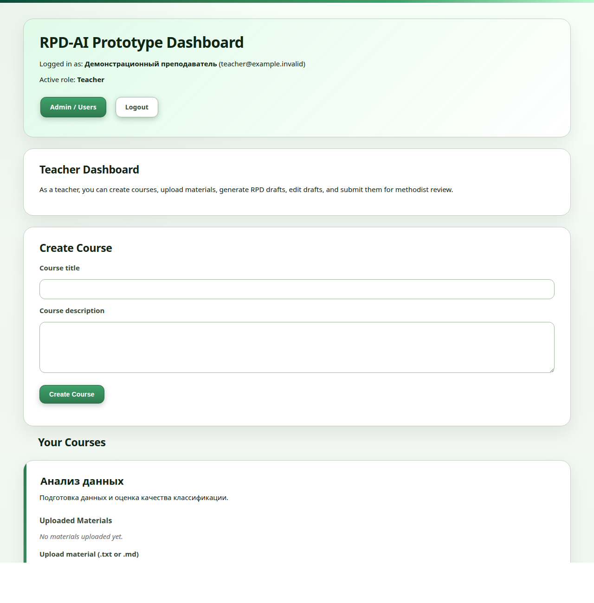

The starting interface provides course creation and access to the teacher workflow. Its course form has only title and description, and controls are mostly English.

### Figure 2 — Existing uploads, generation and draft management

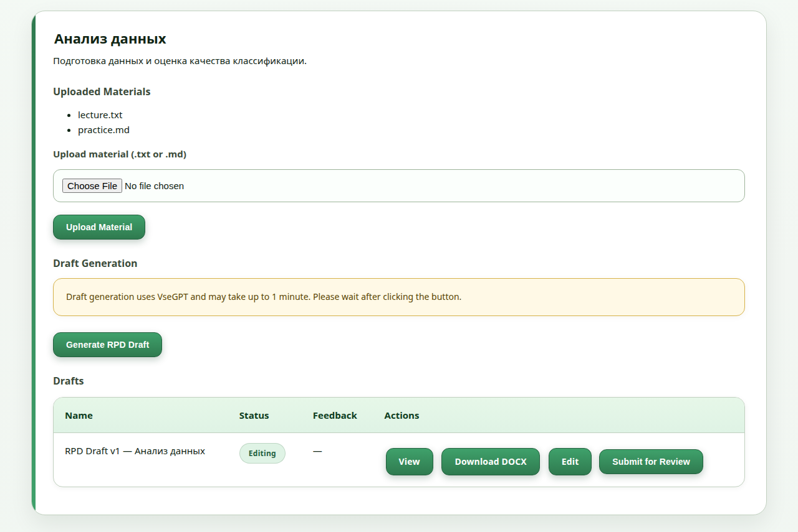

The original course card already combined uploaded materials, the VseGPT generation action and a table of saved drafts. Each draft could be viewed, downloaded as DOCX, edited or submitted for review. This was the central teacher workflow before the autumn changes.

### Figure 3 — Existing browser editor and DOCX access

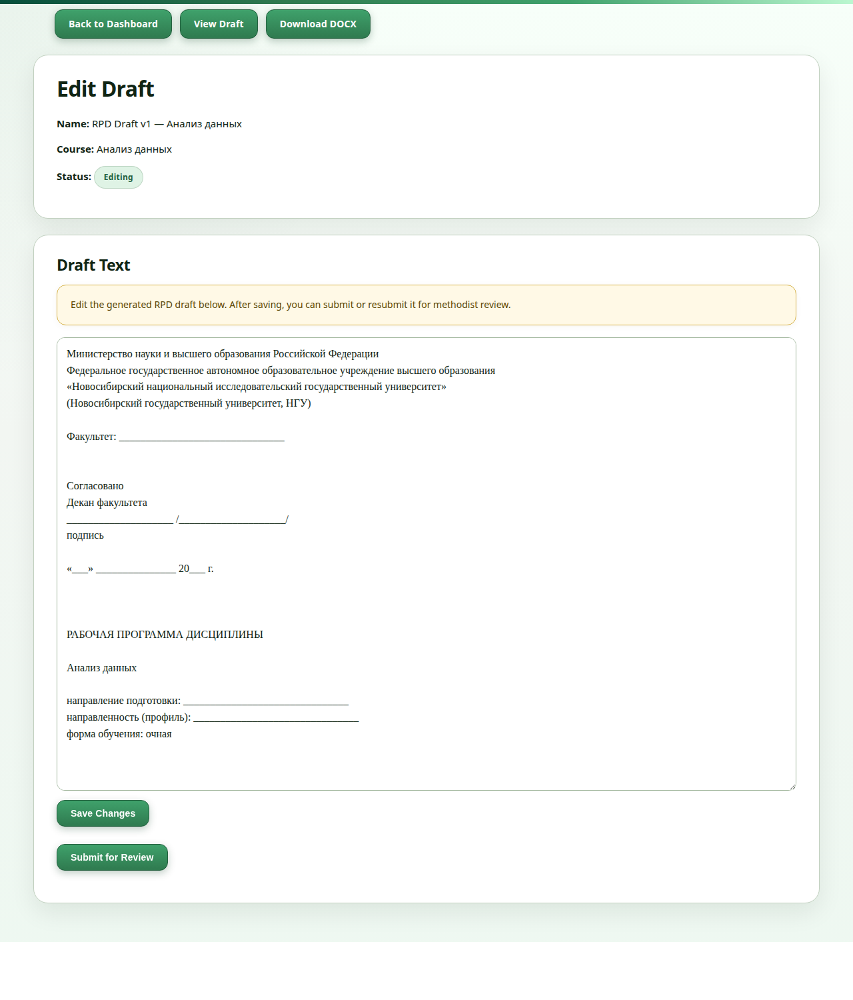

Teachers could already revise the full RPD text in the browser, save changes and submit the draft to a methodist. The navigation also provided a read view and DOCX download. Autumn development improved the generated content and presentation while retaining this manual editing step.

The editor shows the original full-length RPD template, beginning with the university heading, faculty and approval fields, discipline title and program details.

### Figure 4 — Existing methodist inbox

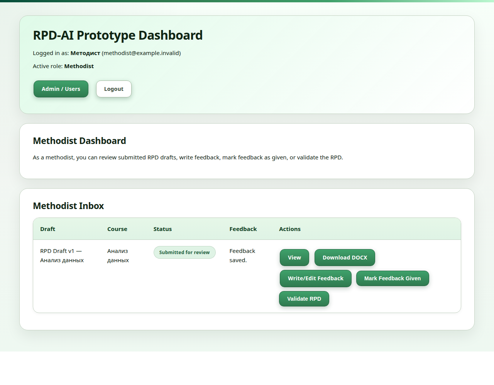

The methodist workspace already collected submitted drafts in an inbox. It displayed course and draft information, review status and feedback availability. The reviewer could open the draft, download it, write feedback, return saved comments to the teacher or mark the RPD as validated in the application.

### Figure 5 — Existing feedback and revision workflow

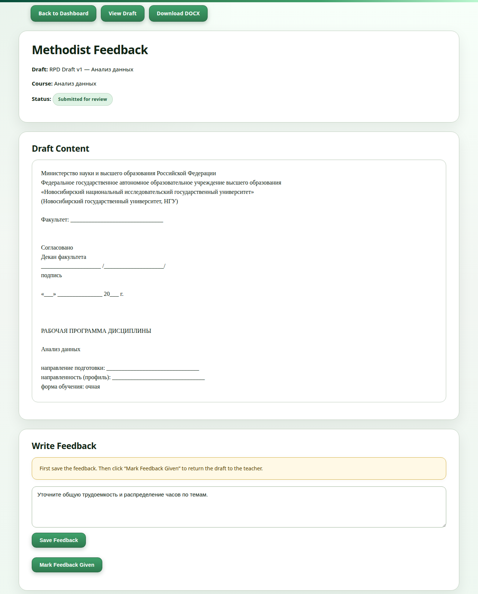

The review screen placed the draft content above the feedback form. Saving comments and selecting “Mark Feedback Given” returned the draft for teacher corrections. Together with editing and resubmission, this already supported an iterative teacher–methodist review cycle.

### Figure 6 — Structured course input

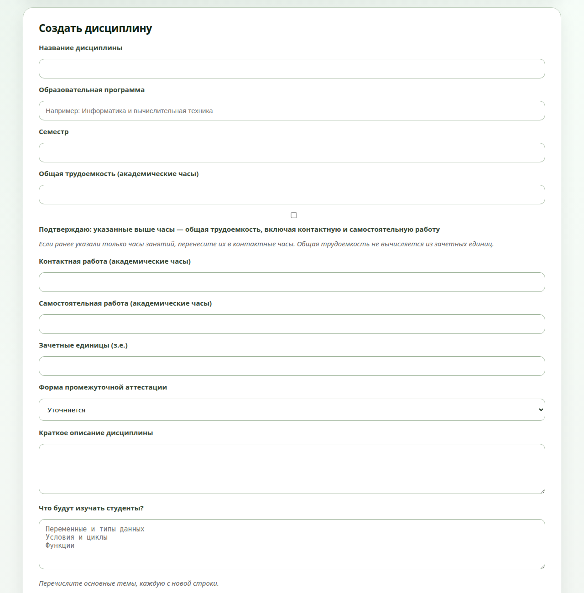

The course form brings program, semester, workload, credits, assessment format, description and topics together. The workload confirmation distinguishes total academic hours from contact hours, while the separate fields record contact and independent work.

### Figure 7 — Source-review evidence

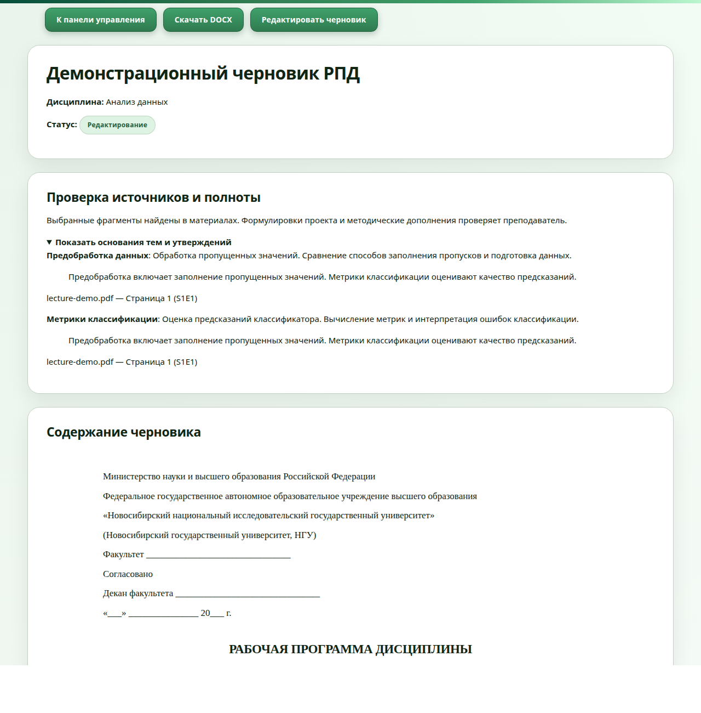

The review panel connects draft topics with excerpts from teaching materials and shows their filenames and locations. This gives the teacher a direct way to check the source behind a topic while reviewing the draft.

### Figure 8 — Competency-search page, working tree

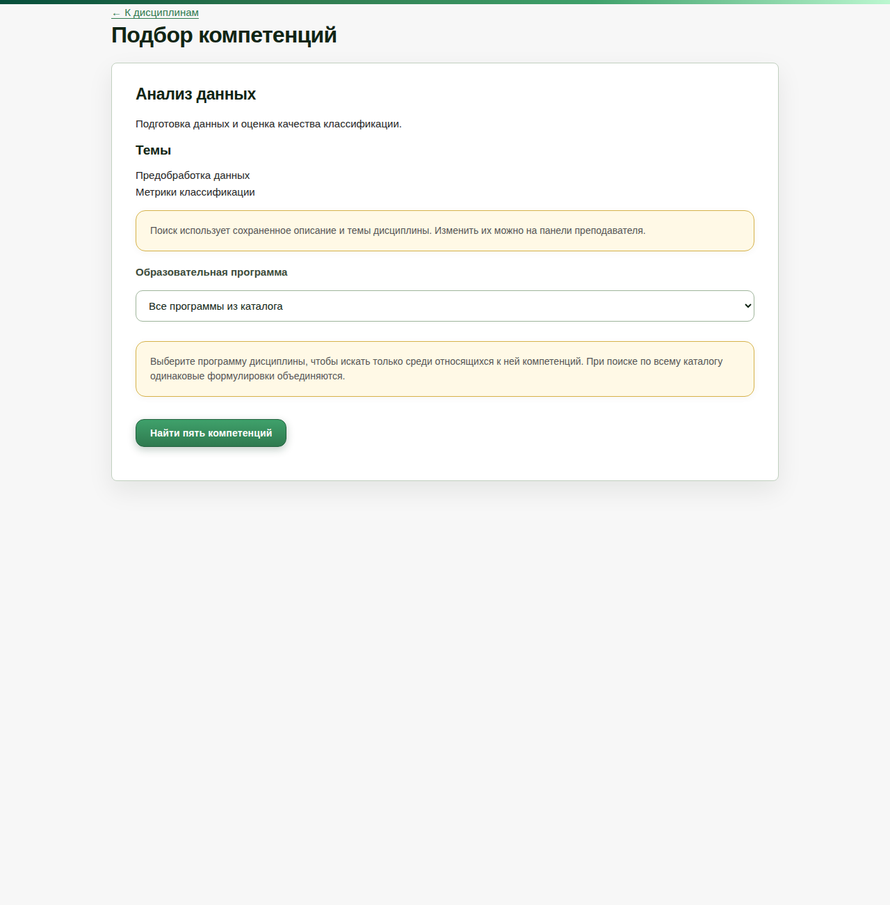

The competency-search page uses the saved description and topics as its search input. The teacher can narrow the search to an educational program and request five suggested competencies from the catalogue.

### Figure 9 — Exported РПД: title page

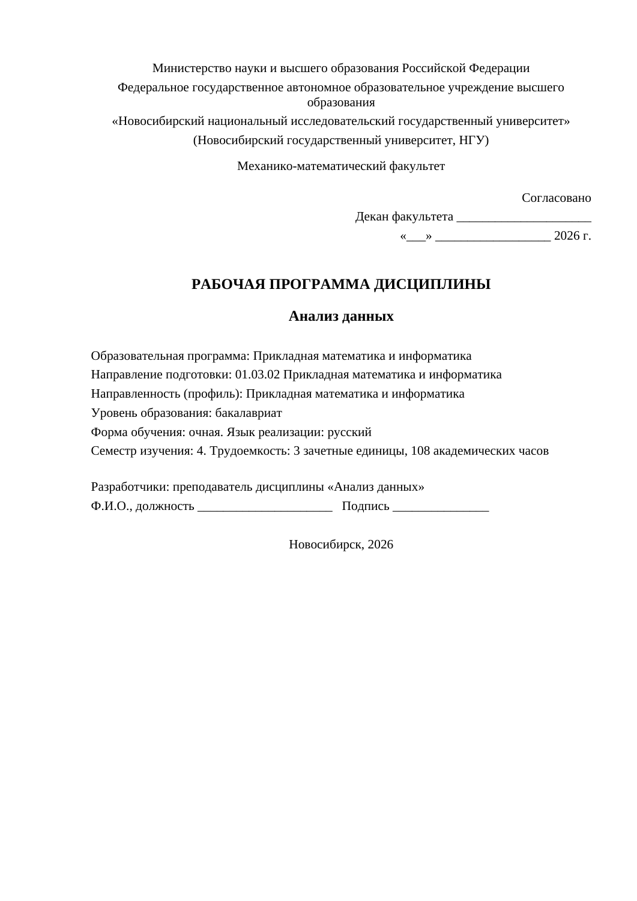

The title page follows the supplied НГУ examples: institutional heading, faculty, approval block, discipline title, program and profile, mode of study and developer details. The example is a fourth-semester bachelor’s course in data analysis, with 3 credits and 108 academic hours.

### Figure 10 — Exported РПД: detailed teaching plan

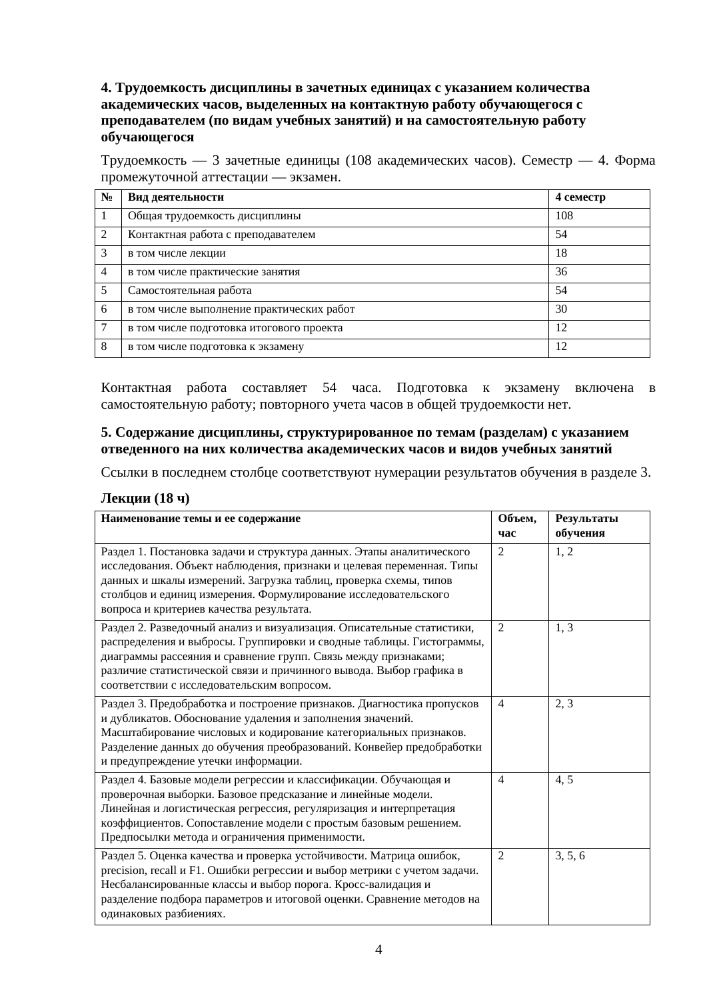

The example follows the reference programs’ detailed table structure, with named topics, hours and links to numbered learning outcomes. Its six topics progress from data quality and exploratory analysis to modeling and reproducible research. The plan allocates 18 hours to lectures, 36 to practical classes and 54 to independent study.

### Figure 11 — Exported РПД: assessment and grading

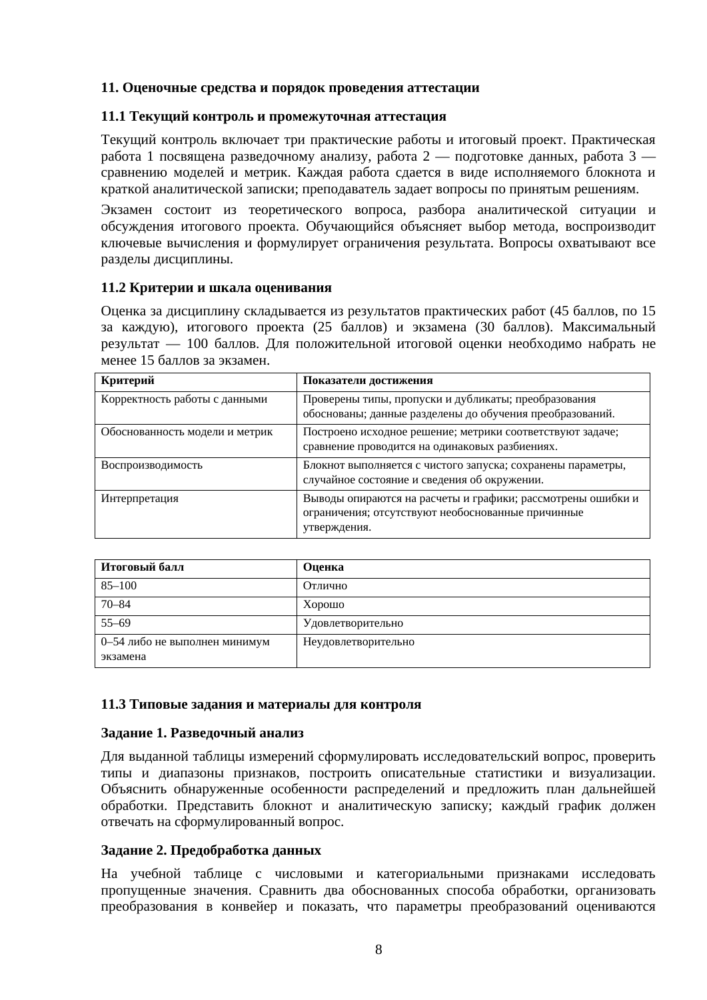

The assessment section specifies practical submissions, the final project, the exam format and grading criteria. The full example also includes competency and learning-outcome tables, reading lists, software requirements, typical assignments and examination questions.

## 6. Validation and remaining work

**All 237 automated tests passed.** Coverage includes authentication, course metadata, document extraction, generation-provider handling, structured teaching content, source evidence, document rendering/export, and competency search. Educational quality and search relevance remain priorities for pilot evaluation.

The next product work is to connect teacher-confirmed competencies to saved courses and generated RPDs; agree on an official template and required fields with a pilot program; evaluate generated content and retrieval relevance on representative examples; and run a timed baseline-versus-assisted pilot. The proposed **50% reduction in time to a complete first draft is a target, not a demonstrated result**. Official approval/signing, university-system integrations and collaborative editing remain outside the stated MVP scope.

## 7. Technical references

- Git baseline: [initial revision 163f265](https://github.com/JuliaMazine/rpd-ai-prototype/tree/163f265).
- Committed endpoint: [revision eaeab71](https://github.com/JuliaMazine/rpd-ai-prototype/tree/eaeab71).
- Local schema/configuration: `app/models.py`, `app/migrate.py`, `app/config.py`, `app/main.py`.
- Extraction/storage: `app/services/text_extraction_service.py`, `app/services/material_service.py`.
- Generation/evidence: `app/services/llm_service.py`, `ollama_service.py`, `rpd_content_service.py`, `rpd_evidence_service.py`, `rpd_example_service.py`.
- Rendering/export: `app/services/document_view_service.py`, `docx_service.py`, `app/templates/draft_view.html`.
- Working-tree search: `app/routes/competency.py`, `app/services/competency_catalogue_service.py`, `competency_search_service.py`, `embedding_service.py`, `app/templates/competencies.html`, `tests/test_competency_search.py`.
