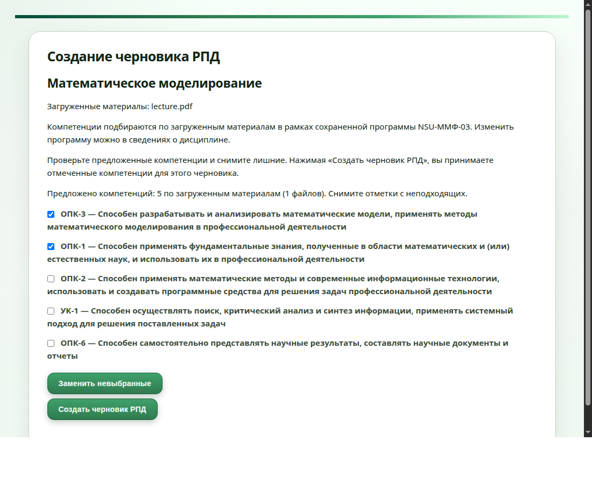
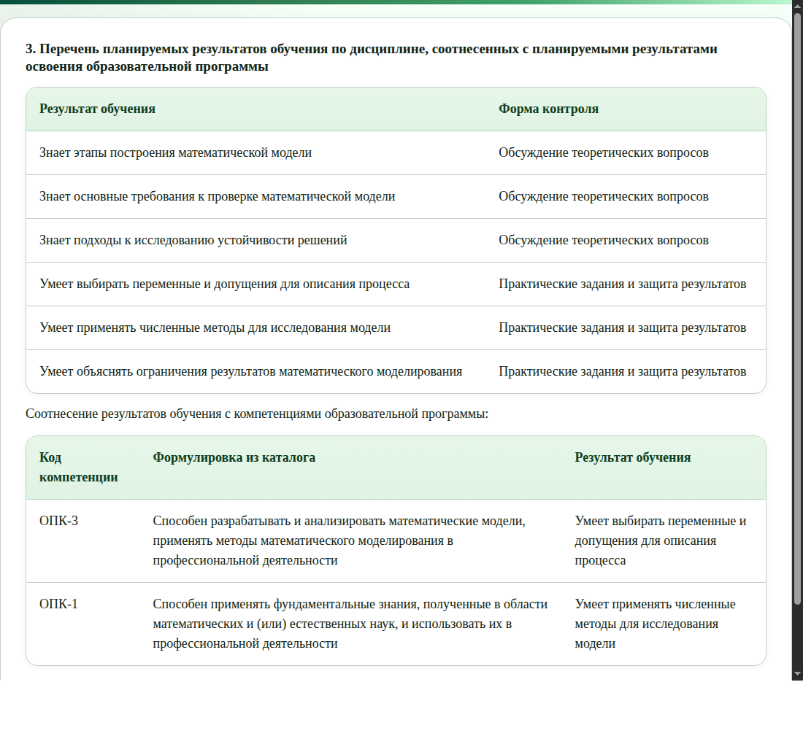

# RPD-AI: weekly technical progress report

**Reporting period: 19–26 October 2026 · Snapshot: 21 October 2026**

Repository: `JuliaMazine/rpd-ai-prototype`.

## 1. Scope and main result

This report covers additions since the autumn report’s 19 October snapshot. The main result is a connected competency workflow: the application suggests competencies from teaching materials, lets the teacher keep or replace suggestions, and uses accepted competencies when generating an RPD.

The report records work available on 21 October; it does not describe later days in the reporting period. The CSV catalogue and basic Ollama generation already existed. Competency search was present as uncommitted work in the autumn snapshot and was completed and committed during this period.

## 2. Additions during the week

| Area | Added behavior |
| --- | --- |
| Competency search — SCRUM-5 | Local embedding search returns up to five distinct competency descriptions from the repository CSV, with original codes and program associations. |
| Search input | Suggestions use sampled excerpts from uploaded materials; the course description and topics provide additional context. |
| Saved program | The course stores a catalogue program ID. Suggestions automatically use that program; no second selection is required during generation. Without a saved program, search covers the whole catalogue. |
| Teacher selection | Suggestions appear as checkboxes in the existing generation form. Clicking Generate accepts the checked entries for that draft. |
| Replacement suggestions | “Заменить невыбранные” retains checked entries and replaces unchecked ones with the next-ranked candidates. Rejected entries remain excluded during subsequent replacements. |
| RPD generation — SCRUM-8 | The generator receives course fields, accepted competencies, and uploaded material excerpts. Catalogue wording and validated learning-outcome links are rendered into the draft and DOCX. |

### Materials-based local search

The search model is separate from the text-generation model. Ollama serves `qwen3-embedding:0.6b`; competency descriptions and the course query are compared using cosine similarity. Repeated descriptions are grouped while retaining their program-specific codes.

The query samples excerpts across uploaded files within a 12,000-character budget. Description and topics contribute up to 2,000 characters each. Saved extracted text is used, so the existing PDF, Word, presentation, notebook, and text upload formats participate in search. With no usable material text, search can use description and topics instead.

Catalogue vectors are cached in a local SQLite index. Changes to description text or embedding-model identity invalidate the relevant cache entries. Search remains local and does not call a paid embedding API.

### Selection and replacement in one form

The teacher reviews five initially checked suggestions directly under “Создание черновика”. Unchecking an unsuitable competency and selecting “Заменить невыбранные” requests an alternative while preserving the checked choices. If alternatives run out, the form explains why fewer than five remain. A failed replacement request preserves the previous selection.

The saved course program is applied automatically. The standalone catalogue-search page remains available for inspection, but it is not a required step before generation.

### Generation with accepted competencies

A signed preview binds suggestions to the course, saved program, uploaded extracted-text fingerprints, and catalogue fingerprint. Its lifetime is one hour. Generation verifies that preview rather than silently rerunning search; changed inputs require fresh suggestions.

The application sends only the accepted entries to the generator and validates proposed competency IDs, learning-outcome references, and duplicate mappings. Exact catalogue codes and descriptions are inserted by the application. An accepted competency without a supported outcome link remains visible with a review placeholder rather than disappearing from the document.

Each draft retains the suggestions, accepted entries, program information, catalogue fingerprint, embedding-model identity, and mappings in generation metadata. Saved drafts retain their original catalogue snapshot. A nullable `catalogue_program_id` course field and an additive database migration support the saved selection.

## 3. Interface examples

The figures use current application templates and synthetic course data. Suggestions come from the local embedding model; the rendered RPD example uses illustrative teaching content and mappings.

### Figure 1 — Suggestions inside the generation form

The form uses the saved program and suggestions from uploaded material. In this example, the teacher keeps two competencies and can replace the remaining three before generating a draft.

### Figure 2 — Competencies in the generated RPD

Accepted catalogue entries are included directly in the RPD, with links to learning outcomes. Their original codes and descriptions are supplied by the application and retained in DOCX export.

## 4. Validation

The latest complete automated run passed **274 tests**. Coverage includes selection validation, changed-material detection, replacement history, course ownership, saved catalogue entries, draft editing, and DOCX export.

Browser checks covered retained checkboxes, replacement of unchecked entries, the all-selected case, and recovery after a failed replacement request. Local-model smoke checks also confirmed that material-only search works without a description or topics and uses the saved program. A local generation/export check retained accepted competencies in the RPD and DOCX.

These checks establish functional behavior. Retrieval still ranks by similarity without a minimum relevance threshold; replacement candidates may be weaker matches. Teacher-rated relevance and educational correctness have not been established by these tests.

Implementation: SCRUM-5 (`4d9b7b0`) and SCRUM-8 (`be01038`), with materials-based suggestions (`43e5145`) and replacement suggestions (`d62383b`).
